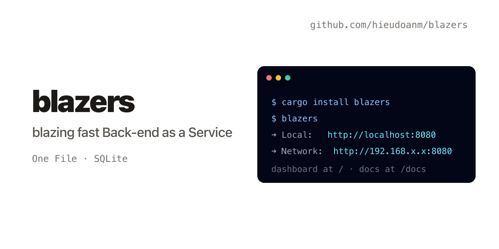
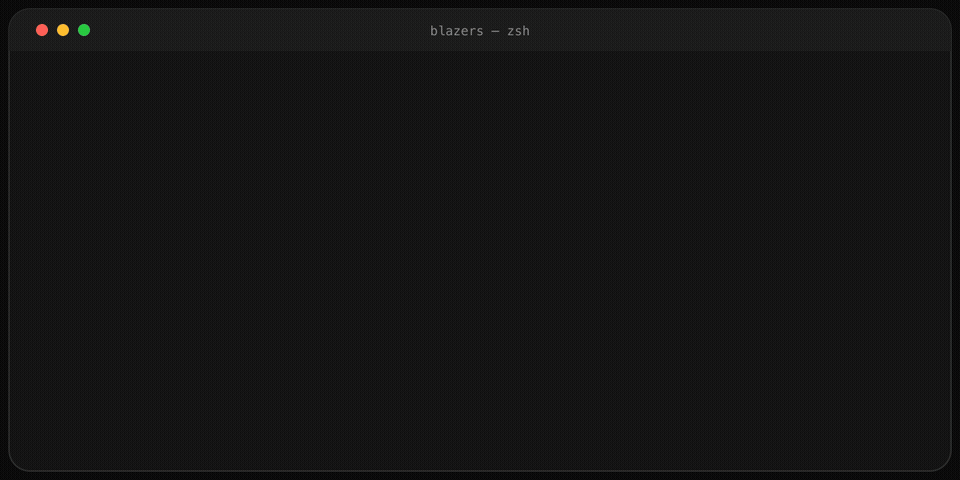

# blazers

[](https://github.com/hieudoanm/blazers/actions/workflows/ci.yaml?branch=master)  [](LICENSE)

Topics: `baaas`, `backend-as-a-service`, `rust`, `sqlite`, `axum`, `mcp`, `self-hosted`


**Blazing fast Back-end as a Service** — a single Rust binary that gives you
auth, a dynamic database, file storage, realtime, webhooks, cron jobs,
encrypted secrets, pub/sub, an admin dashboard and an MCP server. No Docker,
no external services: everything persists to one SQLite file.



**Live demo:** <https://hieudoanm.github.io/blazers/>



Inspired by [PocketBase](https://pocketbase.io/) and
[Supabase](https://supabase.com/), rebuilt as a Cargo workspace.

## Features

| Feature | Endpoint prefix | What it does |
| ------- | --------------- | ------------ |
| Auth | `/api/auth/*` | Register, login, JWT bearer tokens (bcrypt), `/me` profile + custom fields, password reset, email verification, OTP sign-in and OAuth2 (Google/GitHub/GitLab/Discord), TOTP MFA and token refresh via SMTP; managed `users` collection (`/api/auth/users*`) with rule expressions and impersonation |
| Collections & records | `/api/collections/*` | Schema-less collections stored as dynamic SQLite tables; full CRUD, paging, search, sorting, filtering, `?filter=`/`?sort=`/`?expand=` |
| Batch | `/api/batch` | Run up to 50 API calls in one round-trip, per-request results/errors |
| RBAC | `/api/permissions` | Per-user/collection/role access rules **plus** per-collection record rules (`list/view/create/update/delete`) with `@request.auth` expressions |
| Buckets & files | `/api/buckets/*` | Upload/download/delete files, public buckets, protected-file tokens, image thumbnails |
| Realtime | `/ws`, `/api/*/stream` | WebSocket hub with collection subscriptions + automatic record events (`oldRecord` on update/delete); SSE streams for notifications, logs and pub/sub |
| Pub/Sub | `/api/pubsub/*` | Topics, messages, live fan-out over SSE |
| Webhooks | `/api/webhooks` | CRUD plus delivery logs; fired on record events incl. synchronous `record.before_*` hooks that can patch or cancel writes |
| Cron jobs | `/api/cronjobs` | Scheduled HTTP jobs with run logs |
| Secrets | `/api/secrets` | AES-256-GCM encrypted key/value store |
| Cache | `/api/cache`, `blazers kv` | Redis-style KV — strings, lists, hashes, atomic INCR/APPEND, TTL — over REST **and** a Redis-compatible TCP protocol, persisted to SQLite |
| Notifications & logs | `/api/notifications`, `/api/logs` | SSE-streamed notification feed and request/job logs |
| Import / Export | `/api/export`, `/api/import` | Full database snapshot as JSON |
| Backup | `/api/backup` | Download a copy of `data.db`; `backup_schedule` cron setting writes rotating snapshots |
| Admin dashboard | `/` | Embedded HTMX admin UI — no build step, served by the binary |
| OpenAPI | `/api/openapi.json`, `/api/docs` | Swagger UI + spec generated at runtime |
| MCP server | `blazers mcp serve` | Expose collections/records as MCP tools over stdio; `--kv` proxies a remote KV listener |

Full documentation lives at [`/docs`](https://hieudoanm.github.io/blazers/docs/) on the
landing site (source: [`packages/landing/docs/`](packages/landing/docs/README.md)) —
concepts, API reference, and deployment guides.

## Get Started

```bash
cargo build --release
./target/release/blazers          # or: blazers serve
# → http://localhost:8080  (admin dashboard at /, API docs at /api/docs)
```

```bash
curl -X POST localhost:8080/api/auth/register \
  -H 'Content-Type: application/json' \
  -d '{"email":"admin@example.com","password":"secret123"}'

TOKEN=$(curl -s -X POST localhost:8080/api/auth/login \
  -H 'Content-Type: application/json' \
  -d '{"email":"admin@example.com","password":"secret123"}' | jq -r .token)

curl -X POST localhost:8080/api/collections \
  -H "Authorization: Bearer $TOKEN" -H 'Content-Type: application/json' \
  -d '{"name":"posts","schema":{"title":"string","views":"number"}}'
```

## MCP server

The same binary speaks the Model Context Protocol over stdio:

```bash
blazers mcp serve
```

Tools: `blazers_health`, `blazers_collections_list/create/delete`,
`blazers_records_list/get/create/update/delete`, `blazers_export`,
`blazers_import` — all backed by the same SQLite database as the HTTP API.

`blazers mcp serve --kv HOST:PORT` instead proxies a remote `blazers kv`
listener, exposing `blazers_kv_*` tools (ping/set/get/del/keys/ttl/expire)
over the wire protocol — no local database needed.

## KV TCP server

```bash
blazers kv --port 6379
```

Speaks a Redis-style inline protocol (`SET`/`GET`/`DEL`/`KEYS`/`EXPIRE`/`TTL`,
`INCR`, lists, hashes) on the same cache the REST API serves — point `nc`,
`redis-cli`-style clients, or `blazers mcp serve --kv` at it. Set
`BLAZERS_KV_PASSWORD` to require `AUTH`.

## Configuration

| Variable | Default | Purpose |
| -------- | ------- | ------- |
| `PORT` | `8080` | HTTP listen port |
| `BLAZERS_DATA` | `~/.blazers` | Data directory (`data.db`, `secrets.key`, `uploads/`) |
| `JWT_SECRET` | dev value | JWT signing secret — **set in production** |
| `BLAZERS_SECRETS_KEY` | generated | AES-256 key for the secrets vault |

## Repository layout

```text
Cargo.toml                  # workspace manifest
crates/
  blazers-core/             # SQLite storage, migrations, shared models
  blazers-server/           # HTTP API + all BaaS features + embedded dashboard
  blazers-mcp/              # MCP stdio server (JSON-RPC 2.0)
  blazers/                  # thin binary: arg parsing, serve / kv / mcp serve
packages/
  landing/                  # Next.js landing + docs site → GitHub Pages
```

## Commands

```bash
cargo build                  # debug build of the whole workspace
cargo build --release -p blazers
cargo test                   # unit + integration tests (404 tests)
cargo clippy --workspace --all-targets
cargo fmt --all
make all                     # fmt-check + clippy + test + build
```

## Comparison with PocketBase

| PocketBase | Blazers |
| ---------- | ------- |
| Single Go binary, single SQLite file (`pb_data/`) | Single Rust binary, single SQLite file (`~/.blazers/data.db`) |
| Collections & records with JSON field types | Collections & records; schema stored as JSON, rows in dynamic tables |
| `users` auth collection, JWT, record rules | `_users` table (custom `data` fields, `verified`) exposed as a managed auth collection (`/api/auth/users*`, `type: "auth"`, rule expressions); JWT; per-collection `_permissions` + five rule expressions with `@request.auth` |
| File storage buckets + filesystem blobs | `_buckets`/`_files` + `uploads/` dir, thumbnails via `image` crate, public flag + protected-file tokens |
| Realtime subscriptions (SSE/WebSocket) | `/ws` hub with collection subscriptions + automatic record events (`oldRecord` on update/delete); SSE streams for notifications, logs, pub/sub |
| Batch requests (`?batch=1`) | `POST /api/batch` — up to 50 sub-requests per round-trip |
| Hooks (`onRecordBefore*Request`, …) | `record.before_*` webhooks run synchronously and can patch/cancel record writes (JSVM-lite) |
| Cron jobs (add via code) | `/api/cronjobs` CRUD + scheduler, no code required |
| `pb_public` / `superuser` concept | `public` / `user` / `admin` permission roles |
| Admin UI (prebuilt SPA) | Embedded HTMX dashboard served at `/` |
| Go SDK / JS SDK | REST + OpenAPI (`/api/docs`); MCP tools for AI agents |
| Settings via `settings` collection | Env vars + `/api/settings` (SMTP, `app_url`, backup schedule — secrets encrypted) |
| Email/OTP, OAuth2, MFA | Password reset + email verification + OTP + TOTP MFA + OAuth2 (Google/GitHub/GitLab/Discord) + token refresh |
| Backups via `cp -r pb_data` | `GET /api/backup` + scheduled snapshots via `backup_schedule` setting |

Extra vs PocketBase: Redis-style cache (REST + TCP KV protocol), pub/sub topics, notification and
request-log feeds, encrypted secrets vault, import/export JSON snapshots,
rate limiting, and a built-in MCP server.

## License

This project is licensed under the [MIT License](LICENSE).
